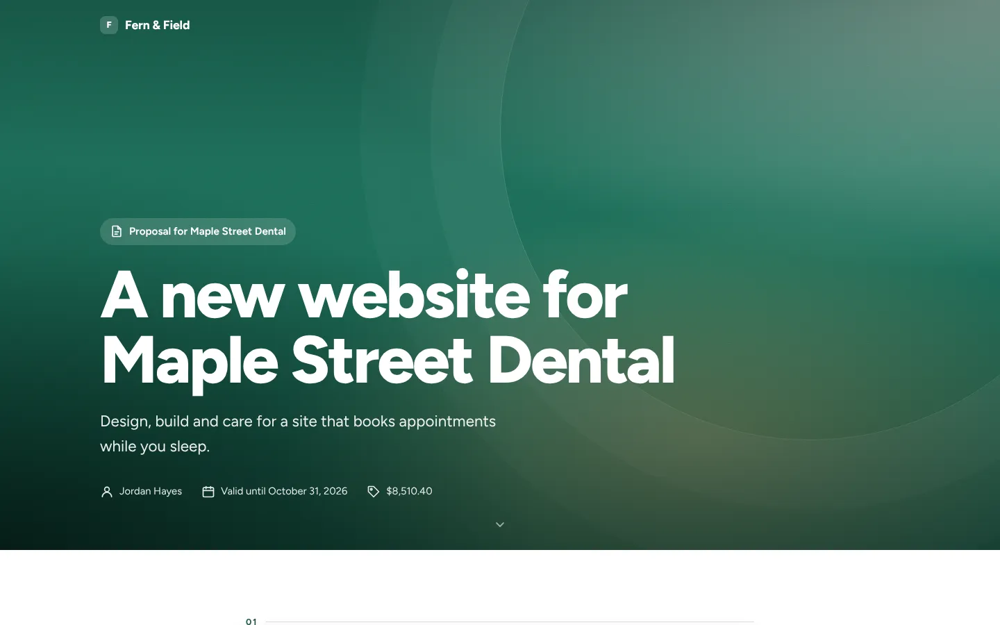
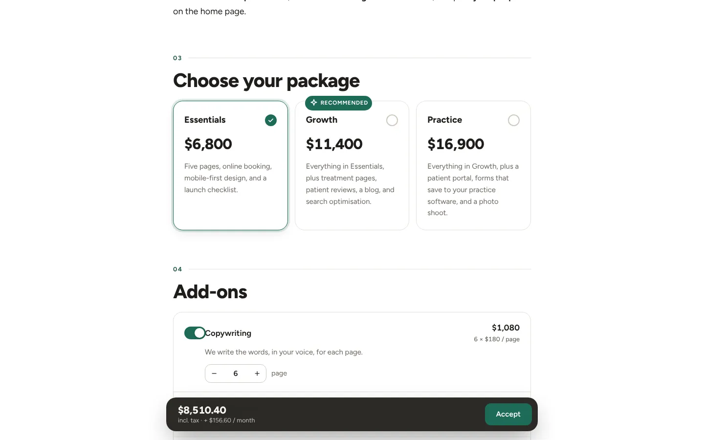
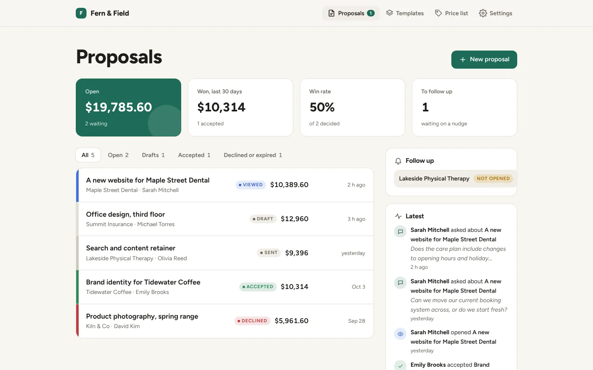
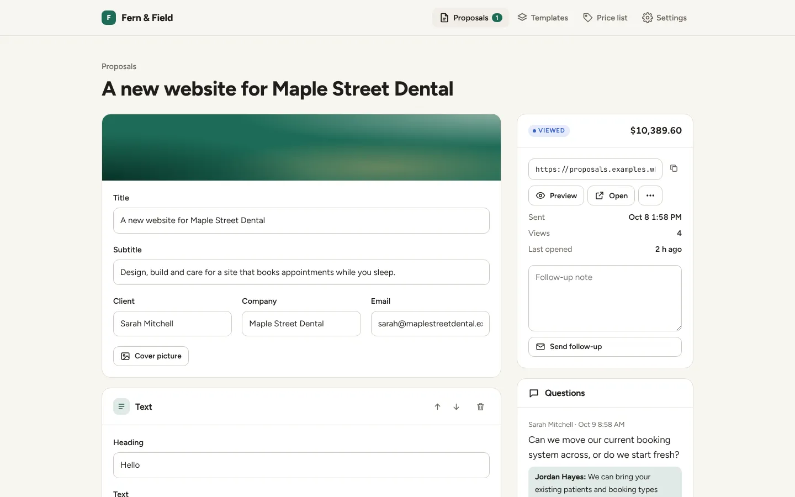
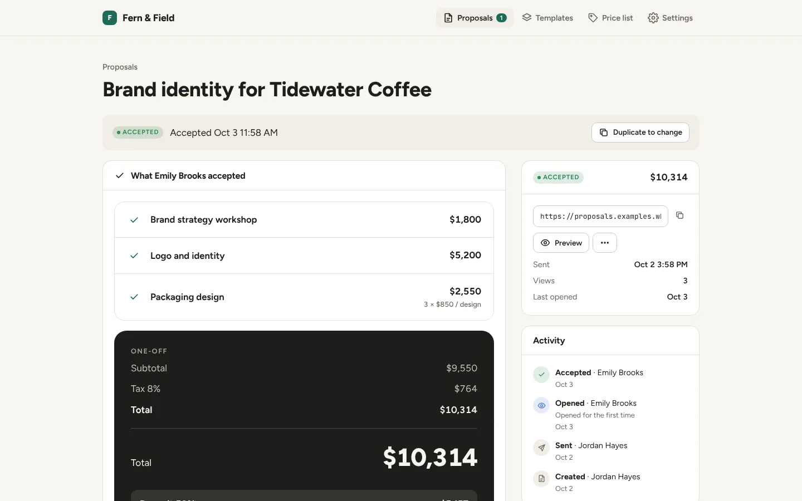
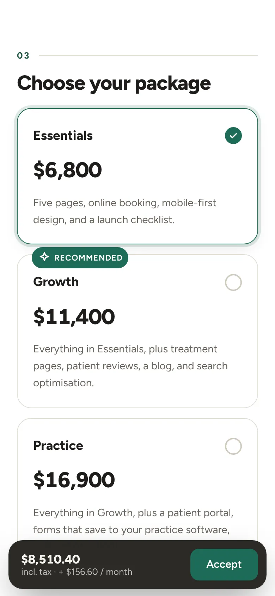
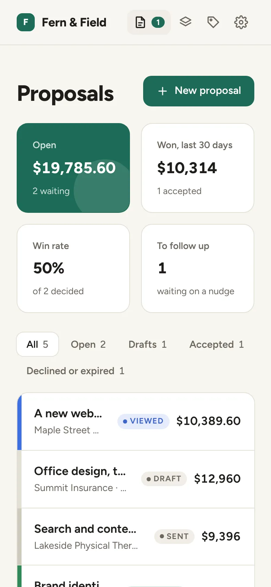

# Proposals

Proposals and quotes your clients open as a web page, pick their options on, and accept with a
signature. It's for agencies, studios, consultants and trades who quote for their work. It
replaces Qwilr, PandaDoc or Proposify for most small businesses.



**[See it live](https://proposals.examples.whisk.page)**. Press **Look around** to use it as staff. It resets every night.

## Deploy your own

Paste this into Claude Code, Codex, Cursor or any coding agent:

> Read https://whisk.run/skill. Then clone https://github.com/Whisk-Hosting/proposals, deploy it to Whisk as a new app, and give me its address.

Your agent signs you up to Whisk if you're new, deploys the app, and gives you its address. It
comes with sample data so every screen has something to show. The sample business, Fern & Field,
has five proposals, a template and a price list. Delete them when you're ready.

Once it's live, ask your agent to make it yours in plain words, for example:

> "Change the business name to Harbor Lane Landscaping, use our logo and dark blue, and set sales tax to 7%."
>
> "Replace the sample price list with our services: lawn care at $65 a visit, spring cleanup at $350, and mulch at $85 a yard."
>
> "Add a site visit date to each proposal and show it on the cover."

Prefer the command line? In a copy of this folder:

```
whisk init --name proposals
whisk deploy
```

Email goes through Whisk email, from your own domain once it is verified in Whisk.

## What is Whisk?

[Whisk](https://whisk.run) hosts business apps built with AI coding agents. Your agent creates the account, pushes the app, and it's live at its own address with sign-in, a database, backups, scheduled jobs, email and security already taken care of. This app is one of the [Whisk examples](https://whisk.run/examples): open source, MIT licensed, and yours to change.

## Screenshots

<table>
  <tr>
    <td width="50%"><br>Clients pick a package and extras; the total updates as they go.</td>
    <td width="50%"><br>Every proposal at a glance, with who to follow up.</td>
  </tr>
  <tr>
    <td width="50%"><br>The editor saves as you type and shows views and questions.</td>
    <td width="50%"><br>An accepted proposal, frozen with what the client chose.</td>
  </tr>
  <tr>
    <td width="50%"><br>On a phone, where most clients open it.</td>
    <td width="50%"><br>The proposal list on a phone.</td>
  </tr>
</table>

## Features

**A web page, not a PDF**
- Each proposal is a page in your colors, with a cover, your words, pictures and prices. Phone first.
- Clients never sign in. Each proposal has its own unguessable link.

**Clients choose**
- Pick-one packages, optional extras with a switch, and quantities the client can change within limits.
- Monthly lines beside one-off ones, plus a discount, sales tax (added, included or none) and a deposit.
- The total updates as they choose.

**Accept and sign**
- A typed or drawn signature, with name and email.
- The accepted proposal is frozen with a SHA-256 fingerprint, the time, IP address and device.
- It downloads as a PDF, and the client gets a receipt by email.

**Know when it's opened**
- An email the first time the client really opens it (link previews don't count), and when they ask a question, accept or decline.
- The proposal list shows views. **Follow up** lists proposals not opened after a day, opened but undecided after three, or about to expire.

**Questions**
- Clients ask on the page. You answer from the editor, and they get the answer by email.

**Faster quoting**
- Templates and a price list, so a new proposal takes a minute.
- Duplicate any proposal, or save it as a template.

**For your other tools**
- Webhooks for `proposal.sent`, `proposal.viewed`, `proposal.accepted` and `proposal.declined`, signed and retried.
- A CSV export and a JSON API with keys made in Settings.

**Staff and permissions**
- Staff are your Whisk team. Everyone writes proposals; owners and admins change settings, make API keys and export.

## API

Everything the screens do, as JSON under `/api/v1`, for scripts and AI agents. An owner or admin
makes a key under **Settings > API keys** (it is shown once; only a hash is kept) and sends it as
`Authorization: Bearer prp_…`. Basic auth with the key as the user name, an `X-Api-Key` header or
`?token=` work too. Money is whole cents; `tax_rate`, `discount` and `deposit` are percentages.

```
# Proposals the client has opened but not decided
curl "https://<your app>/api/v1/proposals?status=viewed" -H "Authorization: Bearer prp_..."

# A new proposal from a template, for a client
curl https://<your app>/api/v1/proposals -H "Authorization: Bearer prp_..." \
  -H "Content-Type: application/json" \
  -d '{"template_id": 1, "title": "Website refresh", "client": {"name": "Ana Silva", "email": "ana@example.com"}}'

# Its prices: a pricing section's whole item list
curl -X PATCH https://<your app>/api/v1/sections/12 -H "Authorization: Bearer prp_..." \
  -H "Content-Type: application/json" \
  -d '{"items": [{"name": "Design", "unit_price_cents": 680000}, {"name": "Hosting", "unit_price_cents": 4500, "mode": "optional", "recurring": "month"}]}'

# Email it to the client (or {"how": "link"} to send the link yourself)
curl -X POST https://<your app>/api/v1/proposals/7/send -H "Authorization: Bearer prp_..." \
  -H "Content-Type: application/json" -d '{"note": "Here is the proposal we talked about."}'

# What clients accepted: who signed, what they chose, the totals
curl https://<your app>/api/v1/acceptances -H "Authorization: Bearer prp_..."
```

`GET /api/v1` lists every endpoint, and needs no key. Lists take `?limit=` (up to 100) and
`?offset=`, and answer `total` and `next_offset` (null on the last page). Errors are
`{"error": {"code", "message", "fix"}}` with 400, 401, 404, 409 (a decided proposal can't change)
or 422. What the API sends, follows up and answers is on the proposal's timeline as
`API key "<name>"`, and emails and webhooks go out as they do from the screens.

### Webhooks

Set a URL under **Settings**. Each delivery is a JSON POST:

```json
{ "id": "evt_…", "type": "proposal.accepted", "created_at": "…",
  "data": { "proposal": { "id": 12, "title": "…", "client": { "name": "…", "company": "…", "email": "…" },
    "currency": "USD", "value_cents": 1106300, "url": "https://…/p/…",
    "accepted_by": { "name": "…", "email": "…" }, "total_cents": 906200, "monthly_cents": 16675,
    "lines": [ … ], "fingerprint": "…" } } }
```

The `webhook-signature` header is `t=<unix time>,v1=<hex HMAC-SHA256 of "<t>.<body>">` with the
signing secret shown in Settings. Anything but a 2xx answer is retried with backoff.

## How it's built

Hono on Node 22, Postgres through `postgres`, Markdown through `marked`, PDFs through Typst, no
front-end framework. Pages render on the server; two small scripts add live totals and signing
(`src/client/proposal.ts`) and saving as you type and uploads (`src/client/staff.ts`).

```
src/pricing.ts       pure: selections, lines, discount, tax, deposit, totals (shared with the page)
src/model.ts         pure: status, follow-ups, the frozen copy, signatures, form values
src/editing.ts       pure: reading the editor's forms into rows
src/store.ts         one small query per function
src/proposals.ts     what the page shows, alerts and webhook bodies
src/events.ts        email and webhooks, recorded first and sent through the Whisk queue
src/routes/          client.ts (/p/<token>) and staff.ts (everything else)
src/api.ts           the JSON API at /api/v1; src/requests.ts is its pure half (checks, shapes)
src/views/           server-rendered HTML and the stylesheet
src/pdf.ts           the accepted proposal as a PDF
src/demo.ts          the live demo's guest button and nightly reset; off unless DEMO=1
migrations/          plain SQL, run in order by src/migrate.ts
```

## Run it locally

`npm test` runs the table tests. `npm run dev` runs it on your laptop against a local Postgres
(`DATABASE_URL`, `WHISK_DEV=1`): uploads and email are answered by a local stand-in.

### The live demo

`demo/whisk.yaml` is the same app with every page public, every write from a page behind a bot
challenge (the API checks keys instead, which a visitor makes in Settings), and `DEMO=1`:
visitors press **Look around**, nothing is emailed or sent, and the data, keys included, resets
every night at 3 am Eastern time. To deploy it, naming the demo app as `<org>/<app>`:

```
WHISK_DEMO_APP=examples/proposals npm run deploy:demo
```

This copies the app to a temporary folder, uses `demo/whisk.yaml` there as `whisk.yaml`, and
deploys it, so this folder's manifest never changes.

## License

MIT
